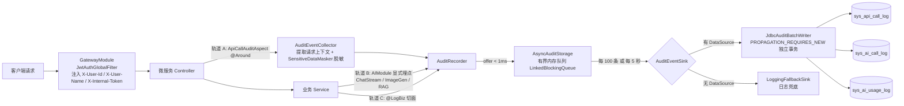

# LoggingModule 日志审计与 AI 使用记录实现流程与使用文档

> 对应设计文档：`docs/superpowers/sdd/2026-11-11-logging-module-design.md`  
> 适用范围：`LoggingModule`（核心实现）、`UserModule`（轨道 A 试点）、`AIModule`（轨道 A + 轨道 B 埋点），以及后续接入的 `PracticeModule`、`AuthModule`。

---

## 一、模块定位与整体架构

`LoggingModule` 采用**双形态打包**设计：
1. **Starter / 库形态（`LoggingModule-0.0.1-SNAPSHOT.jar`）**：被业务微服务以 Maven 依赖引入，通过 Spring Boot `AutoConfiguration.imports` 自动装配切面、收集器、记录器与异步批量写库链路；`maven-jar-plugin` 已排除 `application.yaml`，避免覆盖业务模块自身配置。
2. **独立服务形态（`LoggingModule-0.0.1-SNAPSHOT-exec.jar`）**：端口 `8104`，Nacos 服务名 `logging-server`，可单独启动部署。

### 1.1 整体数据流



### 1.2 核心代码结构

```text
LoggingModule/src/main/java/org/leon/loggingmodule/
├── LoggingModuleApplication.java               # 独立启动入口
├── annotation/
│   ├── LogIgnore.java                          # 逃生舱：标注类/方法跳过轨道 A
│   └── LogBiz.java                             # 轨道 C：敏感业务操作注解
├── config/
│   ├── AuditProperties.java                    # logging.audit.* 配置绑定
│   └── LoggingAuditAutoConfiguration.java      # Spring Boot 自动装配
├── model/
│   ├── AuditEvent.java                         # sealed 顶层事件接口
│   ├── ApiCallEvent.java                       # 轨道 A 事件（对应 sys_api_call_log）
│   ├── AiCallEvent.java                        # 轨道 B 事件（对应 sys_ai_call_log）
│   └── BizAuditEvent.java                      # 轨道 C 事件
├── collector/
│   ├── SensitiveDataMasker.java                # 敏感字段/手机号/邮箱/身份证/Bearer 脱敏
│   └── AuditEventCollector.java                # HTTP 头、IP、耗时、状态码、错误码采集
├── recorder/
│   └── AuditRecorder.java                      # 轨道 A/B/C 统一异步记录入口（含 noop()）
├── aspect/
│   ├── ApiCallAuditAspect.java                 # 轨道 A：Controller 边界 @Around 切面
│   └── BizLogAspect.java                       # 轨道 C：@LogBiz @Around 切面
├── storage/
│   ├── AuditMetrics.java                       # received / dropped / persisted / failed 计数器
│   ├── AuditEventSink.java                     # 批量写入接口
│   ├── JdbcAuditBatchWriter.java               # 独立事务批量写库 + 日汇总 upsert
│   ├── LoggingFallbackSink.java                # 无数据源兜底实现
│   └── AsyncAuditStorage.java                  # 有界队列 + 定时/批量刷盘 + 故障降级
└── exception/
    └── AuditLoggingException.java              # 内部异常（绝不向业务抛出）
```

---

## 二、三轨实现流程详解

### 2.1 轨道 A：Controller 层全量接口自动记录（AOP）

由 `ApiCallAuditAspect` 自动拦截 `org.leon..*` 包下所有带 `@RestController` / `@Controller` 且标注了 `@RequestMapping`、`@GetMapping`、`@PostMapping`、`@PutMapping`、`@DeleteMapping`、`@PatchMapping` 的方法。

**执行步骤：**
1. 检查总开关 `logging.audit.enabled`；为 `false` 直接放行。
2. 检查方法或类上是否标注 `@LogIgnore`；有则直接放行。
3. 使用 `AntPathMatcher` 校验 `request.getRequestURI()` 是否命中 `exclude-paths`（默认排除 `/actuator/**`、`/error`、`/swagger-ui/**`、`/v3/api-docs/**`）。
4. 按 `sample-rate` 采样（默认 `1.0` 全量）。
5. 记录开始时间 `System.nanoTime()`，执行 `joinPoint.proceed()`；若业务抛异常则捕获用于采集错误码与脱敏错误信息，随后**原样重新抛出**。
6. 在 `finally` 中通过 `AuditEventCollector.collectApiCall(...)` 组装 `ApiCallEvent` 并调用 `AuditRecorder.recordApiCall(...)` 入队。所有审计逻辑均包裹在 `try/catch` 内，审计异常绝不影响业务返回。

**字段来源映射：**

| 数据库字段 | 提取来源 | 说明 |
|---|---|---|
| `trace_id` / `span_id` | 请求头 `X-Trace-Id` / `X-Span-Id` | 缺失时自动生成 UUID / 16 位十六进制 |
| `user_id` / `user_name` | 请求头 `X-User-Id` / `X-User-Name` | 由网关 `JwtAuthGlobalFilter` 注入，未登录为 `NULL` |
| `source_service` | 请求头 `X-Source-Service` | 缺失时有 `X-Internal-Token` 记 `gateway`，否则记 `direct` |
| `target_service` | `spring.application.name` | 被调微服务名 |
| `request_uri` | `requestURI + queryString` | 经 `SensitiveDataMasker.maskUri` 脱敏并截断至 512 字符 |
| `remote_addr` | `X-Forwarded-For` 首跳 → `X-Real-IP` → `remoteAddr` | 还原真实客户端 IP |
| `status_code` / `error_code` / `error_msg` | `HttpServletResponse` + 返回值/异常 | 反射读取业务返回体 `getCode()/getMsg()` 或异常信息并脱敏 |

---

### 2.2 轨道 B：AI 用量显式埋点（AIModule）

AI Token 用量只在流式结束帧或上游返回后才可知，且需要关联 `conversation_id` / `message_id` / `provider` / `upstream_model`，因此在 `AIModule` 的三个业务终点显式调用 `AuditRecorder.recordAiCall(AiCallEvent)`：

1. **流式对话（`ChatStreamService`）**
   - 在 `subscribeAsync(...)`（仍在 HTTP 请求线程）捕获 `X-Trace-Id`、`X-User-Id`、`provider`、`modelKey`、`upstreamModel` 与起始时间戳，存入 `ConcurrentHashMap<Long, StreamAuditMeta>`（按 `messageId` 索引），避免进入异步线程池后丢失请求头。
   - 四个终态出口均会取出元数据并写入一条 `sys_ai_call_log`（`service_type = "CHAT"`）：
     - `onComplete`：`status = "done"`，记录 `promptTokens`、`completionTokens`、`reasoningTokens`、`totalTokens = prompt + completion`（**不累加** `reasoningTokens`）。
     - `onError`：`status = "failed"`，记录脱敏后的 `errorMsg`。
     - `truncate`（用户主动 stop / 客户端断连 / 超时）：`status = "truncated"`，记录 `stopReason`。
     - 线程池拒绝（`RejectedExecutionException`）：`status = "failed"`。
2. **AI 生图（`ImageGenService.generate`）**
   - 成功上传 MinIO 后记录 `service_type = "IMAGE"`、`status = "done"`、`provider`、`modelKey`、`upstreamModel`、`costMs`。
   - 发生异常时记录 `status = "failed"` 及脱敏后的 `errorMsg`，再原样抛出异常。
3. **RAG 检索（`RetrievalService.searchKnowledge`）**
   - 混合检索返回后记录 `service_type = "RAG"`、`status = "done"`、`userName = options.ownerName()`、`costMs`。
   - 检索异常时记录 `status = "failed"` 及脱敏后的 `errorMsg`，再原样抛出异常。

> 所有被改造的 Service 均保留原有构造函数重载（默认注入 `AuditRecorder.noop()`），确保现有单元测试零破坏。

---

### 2.3 轨道 C：业务敏感操作注解（`@LogBiz`）

在需要审计的关键业务方法（如注册、提交判题、修改密码）上标注：

```java
@LogBiz(value = "提交判题", type = "OJ_SUBMIT")
public SubmitResult submit(SubmitRequest req) {
    ...
}
```

`BizLogAspect` 会自动记录 `traceId`、`userId`、`userName`、`targetService`、`bizType`、`bizDesc`、`handlerMethod`、`success`、`errorMsg`、`costMs`。

---

## 三、异步批量写入、独立事务与降级机制

### 3.1 异步缓冲与刷盘（`AsyncAuditStorage`）
- **非阻塞入队**：调用 `LinkedBlockingQueue.offer(event)`，耗时 `< 1 ms`。
- **队满策略**：默认丢弃新事件，累加 `dropped` 计数并打印 WARN 日志，绝不阻塞业务线程。
- **双触发刷盘**：
  1. 队列长度达到 `batch-size`（默认 `100`）时立即触发异步刷盘；
  2. 后台单线程定时调度器每 `flush-interval-seconds`（默认 `5` 秒）刷盘一次；
  3. 应用关闭时通过 `@PreDestroy` 自动将内存残余事件刷盘后优雅退出。

### 3.2 独立事务边界（`JdbcAuditBatchWriter`）
- 使用独立 `DataSourceTransactionManager` + `TransactionTemplate(PROPAGATION_REQUIRES_NEW)` 执行 `JdbcTemplate.batchUpdate(...)`。
- **业务事务回滚不会撤销审计记录**；审计写库异常也不会导致业务事务回滚。
- 当 `logging.audit.enable-usage-rollup=true` 且事件含 `userId`、`userName`、`modelKey` 与正数 `totalTokens` 时，自动执行 `INSERT ... ON DUPLICATE KEY UPDATE` 累加到 `sys_ai_usage_log`（扩展汇总表写入异常会被捕获忽略，不影响 `sys_ai_call_log` 主表）。

### 3.3 故障降级与运维指标
- 若审计数据库宕机或建表未执行，`AsyncAuditStorage` 会捕获全部异常、累加 `failed` 计数并输出内部日志，业务请求完全不受影响。
- 若应用上下文不存在 `DataSource`（如单元测试切片或纯网关服务），自动装配切换为 `LoggingFallbackSink`，仅输出结构化摘要日志。
- `AuditMetrics` 提供四个计数器：
  - `received`（总入队数）
  - `dropped`（队满丢弃数）
  - `persisted`（成功落库数）
  - `failed`（写库失败数）

---

## 四、脱敏规则与配置说明

### 4.1 脱敏规则（`SensitiveDataMasker`）
- **URI 查询参数与键值对**：命中 `sensitive-fields` 列表的键统一替换为 `***`。
- **手机号**：保留前三后四（如 `138****1234`）。
- **邮箱**：保留前缀首字符（如 `l***@example.com`）。
- **身份证号**：保留前四后四（如 `1101**********123X`）。
- **Bearer Token**：`Bearer ***`。
- **姓名脱敏**：`maskName("张三丰")` → `张**`。

### 4.2 配置项（Nacos / `application.yaml`）

```yaml
logging:
  audit:
    enabled: true                         # 总开关（默认 true）
    exclude-paths:                        # 排除路径（支持 Ant 风格或前缀）
      - /actuator/**
      - /error
      - /swagger-ui/**
      - /v3/api-docs/**
    sample-rate: 1.0                      # 采样率 0.0 ~ 1.0
    sensitive-fields:                     # 脱敏字段名列表
      - password
      - token
      - authorization
      - smsCode
      - idCard
      - phone
    queue-capacity: 10000                 # 有界队列容量
    batch-size: 100                       # 单批写入条数
    flush-interval-seconds: 5             # 定时刷盘间隔（秒）
    retention-days: 90                    # API 日志保留天数（预留）
    ai-retention-days: 180                # AI 日志保留天数（预留）
    enable-usage-rollup: true             # 是否同步按天汇总 sys_ai_usage_log
```

---

## 五、快速接入与使用指南

### 5.1 给新微服务接入轨道 A（如 `PracticeModule` / `AuthModule`）

1. 在目标模块的 `pom.xml` 中添加依赖：
   ```xml
   <dependency>
       <groupId>org.leon</groupId>
       <artifactId>LoggingModule</artifactId>
       <version>0.0.1-SNAPSHOT</version>
   </dependency>
   ```
2. 无需修改任何 Controller 代码，启动后即自动通过 `LoggingAuditAutoConfiguration` 生效。
3. 如某个高频心跳或健康检查接口不想被记录，直接在类或方法上加 `@LogIgnore`：
   ```java
   @LogIgnore
   @GetMapping("/health")
   public String health() {
       return "ok";
   }
   ```

### 5.2 在业务中扩展新的 AI 用量埋点（轨道 B）

注入 `AuditRecorder` 并在调用结束后记录：

```java
auditRecorder.recordAiCall(AiCallEvent.builder()
        .userName(userName)
        .serviceType("EVAL")          // 可扩展新类型，无需改表结构
        .provider("deepseek")
        .modelKey("deepseek-chat")
        .upstreamModel("deepseek-chat")
        .promptTokens(promptTokens)
        .completionTokens(completionTokens)
        .costMs(costMs)
        .status(AiCallEvent.STATUS_DONE)
        .build());
```

---

## 六、数据库初始化与常用查询 SQL

### 6.1 执行建表迁移脚本

首次部署或本地联调前，对本地 MySQL `ezpracticeexercises` 库手工执行一次：

```sql
SOURCE db/migration/2026-11-11-logging-audit.sql;
```

### 6.2 常用审计查询

```sql
-- 1. 查看某用户最近 20 次接口调用
SELECT create_time, trace_id, target_service, http_method, request_uri, status_code, cost_ms, error_msg
FROM sys_api_call_log
WHERE user_name = 'leon'
ORDER BY create_time DESC
LIMIT 20;

-- 2. 按天与模型统计 AI Token 消耗（直接查调用明细）
SELECT DATE(create_time) AS stat_date, service_type, model_key,
       COUNT(*) AS call_cnt,
       SUM(prompt_tokens) AS prompt_sum,
       SUM(completion_tokens) AS completion_sum,
       SUM(total_tokens) AS total_sum
FROM sys_ai_call_log
WHERE status = 'done'
GROUP BY DATE(create_time), service_type, model_key
ORDER BY stat_date DESC, total_sum DESC;

-- 3. 查询按用户按天的 Token 汇总表
SELECT stat_date, user_id, user_name, service_type, model_key, total_tokens
FROM sys_ai_usage_log
ORDER BY stat_date DESC, total_tokens DESC
LIMIT 50;
```

---

## 七、构建、测试与排查

### 7.1 运行测试（JDK 21）

```powershell
# 运行 LoggingModule 全量单测（含 H2 独立事务批量写库测试）并打包
mvn -pl LoggingModule -am test package

# 运行 AIModule 轨道 B 埋点及相关单测
mvn -pl AIModule -am test -Dtest=AiAuditRecordingTest,ChatStreamServiceTest,ChatStreamWriteCountTest,ImageGenServiceTest -Dsurefire.failIfNoSpecifiedTests=false

# 验证 UserModule 试点编译
mvn -pl UserModule -am test-compile
```

### 7.2 常见问题排查
- **接口调用了但 `sys_api_call_log` 没数据**：
  1. 检查 `logging.audit.enabled` 是否为 `true`、路径是否命中 `exclude-paths`、方法是否标注了 `@LogIgnore`；
  2. 默认异步刷盘周期为 5 秒（或满 100 条），等待 5 秒后再查库；
  3. 检查控制台是否有 `[audit] 批量写入 sys_api_call_log 失败` 告警（通常是未执行 `2026-11-11-logging-audit.sql` 建表）。
- **`user_id` / `user_name` 为 `NULL`**：说明请求未经过网关 JWT 校验（如白名单路径或直连下游未携带 `X-User-Id` / `X-User-Name` 请求头），属预期行为。
- **业务回滚后审计表仍有记录**：属刻意设计（`PROPAGATION_REQUIRES_NEW` 独立事务），用于保留失败/异常调用的完整审计痕迹。
